# Exec architecture and runtime catalog

**Source baseline:** [`f314d657ac451`](https://github.com/kiseyno-AI/kai-trading-exec/tree/f314d657ac451cdca68246bd2b64c45afa71c7bb), the latest observed main at the start of the 2026-11-08 audit, including the post-ACK bookkeeping and browser-origin changes.

This describes source behavior, not the credentials, runtime mode, feature flags, or network policy of a running deployment. The [correctness audit remains incomplete](../audit/2026-11-08-checkpoint.md). Locally tested patches and pending regressions are recorded there; they are not included in this documentation-only commit.

Solid arrows describe the calls or state dependencies named in each section. Separate workers can run concurrently; a dependency diagram does not imply parallel execution within one worker.

## Responsibility and execution boundary

Exec receives execution contracts, persists execution state, applies runtime gates, submits broker orders, and reconciles broker observations. Core produces strategy decisions and execution-plan material. A plan acknowledgement identifies durable intake; subsequent work depends on activation binding, sizing policy, controls, account evidence, and final broker checks.

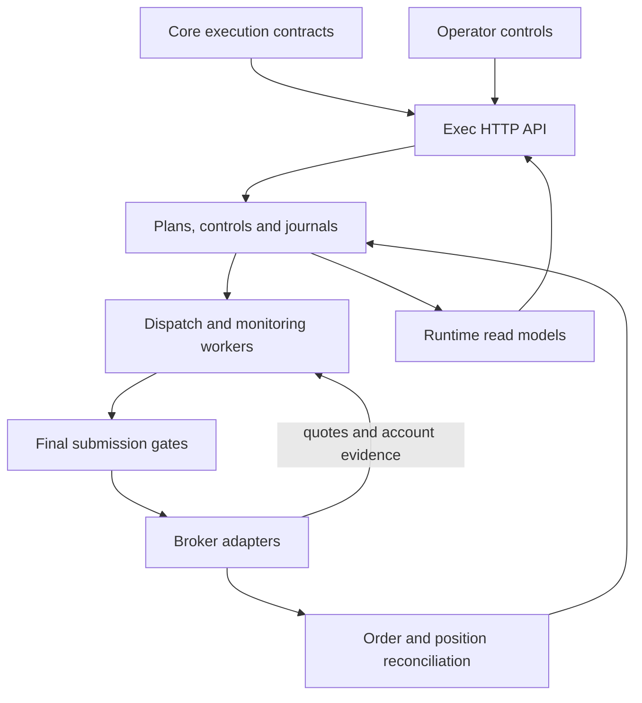

The broker adapter call is the external side-effect boundary. `place_broker_order` serializes an order-intent scope; `_place_broker_order_serialized` persists intent before invoking `adapter.place_order`. ACKs, fill evidence, plan-item transitions, and reconciliation events are separate durable facts. Recovery paths exist, but several adverse interleavings have confirmed audit findings.

| Layer | Main implementation | Owned state or responsibility |
| --- | --- | --- |
| HTTP and controls | `api/routes`, `runtime_controls.py` | Authenticated intake, explicit controls, and read endpoints |
| Plan contract | `core_handoff_v4.py`, `core_buy_authority.py` | Accepted identities, exact family bindings, activation and scoped market authority |
| Scheduling and monitoring | `execution_jobs.py`, `autonomous_runtime.py`, `monitoring.py` | Due jobs, bounded quote work, trigger evaluation, checkpoints |
| Sizing and decisions | `watch_exec_agent_sizing.py`, `trigger_time_exec_agent.py` | Verified decision evidence inside deterministic execution limits |
| Broker boundary | `broker_orders.py`, `broker_auth.py`, adapters | Persisted intent, route/account checks, submission and acknowledgement |
| Execution truth | `reconciliation.py`, `fill_idempotency.py`, `fifo_inventory.py` | Broker observations, fill identity, canonical inventory and chronology |
| Feedback and operations | `trade_outcome_feedback.py`, `weekly_trade_review.py`, repair services | Outcome evidence, advisory review artifacts, bounded remediation |

**Sources:** [execution routes](https://github.com/kiseyno-AI/kai-trading-exec/blob/f314d657ac451cdca68246bd2b64c45afa71c7bb/apps/api/app/api/routes/execution.py), [broker orders](https://github.com/kiseyno-AI/kai-trading-exec/blob/f314d657ac451cdca68246bd2b64c45afa71c7bb/apps/api/app/services/broker_orders.py), [reconciliation](https://github.com/kiseyno-AI/kai-trading-exec/blob/f314d657ac451cdca68246bd2b64c45afa71c7bb/apps/api/app/services/reconciliation.py), [runtime read models](https://github.com/kiseyno-AI/kai-trading-exec/blob/f314d657ac451cdca68246bd2b64c45afa71c7bb/apps/api/app/services/runtime.py).

## Startup, readiness and shutdown

`create_app` constructs the database/session factory, broker adapter factory, monitoring price source, and three coordinators: the main autonomous runtime, Alpaca crypto runtime, and Alpaca US-equity runtime. Construction does not itself start their loops.

During lifespan startup, requested automation triggers schema/readiness inspection. A failed inspection marks workers blocked and records `runtime_startup_gate`. On success, the application repairs only the recognized legacy lifespan-shutdown pause, initializes durable controls, and calls coordinator startup. Each coordinator checks its own enable switch. HTTP availability and trading-worker readiness are therefore separate observations.

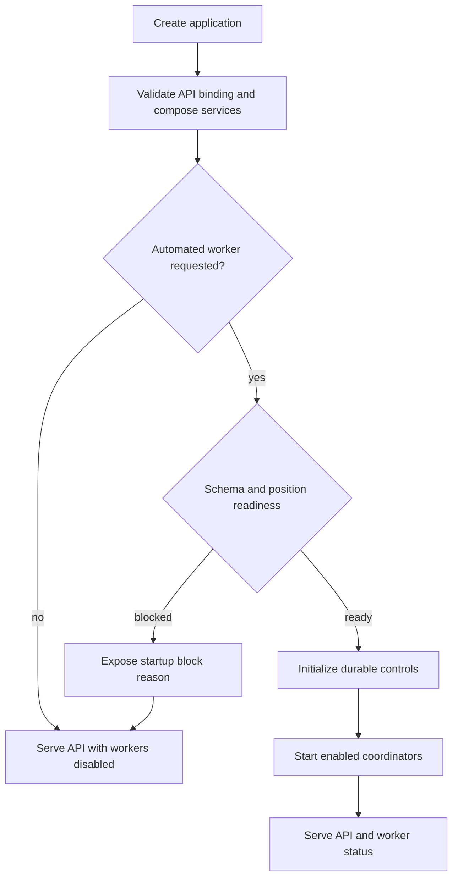

Without a configured bearer token, the application validates loopback binding and checks the request's loopback origin. Cross-origin browser writes have a separate rejection. With a token, authentication applies outside the health/OPTIONS exceptions. These checks describe the implemented boundary; they do not assert complete malformed-input coverage or a deployment's network configuration.

Shutdown closes runtime cycle admission and drains in-flight work. The main lifespan stops every coordinator, including when an earlier stop fails, without treating a Core restart as an Exec lifecycle event. The shutdown path preserves operator control intent.

**Sources:** [`create_app`, security middleware, and coordinator shutdown](https://github.com/kiseyno-AI/kai-trading-exec/blob/f314d657ac451cdca68246bd2b64c45afa71c7bb/apps/api/app/main.py), [`AutonomousRuntimeCoordinator.start`, `begin_shutdown`, `stop`, `wait_stopped`](https://github.com/kiseyno-AI/kai-trading-exec/blob/f314d657ac451cdca68246bd2b64c45afa71c7bb/apps/api/app/services/autonomous_runtime.py), [cycle and commit fences](https://github.com/kiseyno-AI/kai-trading-exec/blob/f314d657ac451cdca68246bd2b64c45afa71c7bb/apps/api/app/services/runtime_shutdown.py).

## Worker catalog and code defaults

The main coordinator creates separate dispatch and monitoring tasks. Optional switches add watch-sizing and NXT-eligibility tasks. Live mode adds KRX daily position discovery. Schedules and status records are distinct even though workers share service code and durable state.

| Worker | Entry point | Work and scheduling |
| --- | --- | --- |
| Execution jobs | `_dispatch_cycle_sync` | Dispatch due jobs, retain the next due time, and limit otherwise idle database rescans to 60 seconds; committed changes refresh monitoring state. |
| Monitoring | `_monitoring_cycle_sync_guarded` → `_monitoring_cycle_sync` | Prevent overlap, refresh due broker truth, select a bounded quote batch, evaluate cached triggers, and enter database-backed actions as needed. |
| Watch sizing | `_watch_exec_agent_sizing_cycle_sync` | Run delegated sizing when its worker switch and time policy permit it. |
| Daily KRX discovery | `_run_daily_krx_position_discovery_loop` | Live-only current-session position discovery. |
| NXT eligibility | `_nxt_eligible_sync_cycle_sync` | Refresh eligibility separately from order submission. |
| Alpaca crypto | `AlpacaCryptoRuntimeCoordinator` | Provider worker with independent monitoring/reconciliation intervals and strategy switches. |
| Alpaca US equity | `AlpacaUsEquityRuntimeCoordinator` | Separate worker for configured US-equity symbols and controls. |

| Setting | Baseline default |
| --- | --- |
| Runtime mode / broker provider | `mock` / `kis` |
| Automation / autonomous runtime | Disabled / disabled |
| Dispatch / monitoring intervals | 1 second / 1 second |
| Domestic closed-market idle interval | 60 seconds |
| Exec agent / watch-sizing worker | Disabled / disabled |
| Watch-sizing interval / configured local window | 60 seconds / 08:00–20:00 |
| Alpaca crypto / US-equity monitoring | Both disabled; each configured interval is 15 seconds |
| Alpaca crypto / US-equity reconciliation | 30 seconds each |
| KIS US trading / KIS US live trading | Disabled / disabled |
| Alpaca live / Upbit live trading | Disabled / disabled |

Intervals are scheduling settings, not cycle-completion promises. Provider latency, closed-market behavior, and persisted gates can defer work. The supplied paper launchers override some code defaults; see the root README's runtime matrix.

**Sources:** [`Settings`](https://github.com/kiseyno-AI/kai-trading-exec/blob/f314d657ac451cdca68246bd2b64c45afa71c7bb/apps/api/app/core/config.py), [worker startup, dispatch, and monitoring](https://github.com/kiseyno-AI/kai-trading-exec/blob/f314d657ac451cdca68246bd2b64c45afa71c7bb/apps/api/app/services/autonomous_runtime.py), [Alpaca crypto coordinator](https://github.com/kiseyno-AI/kai-trading-exec/blob/f314d657ac451cdca68246bd2b64c45afa71c7bb/apps/api/app/services/alpaca_crypto_runtime.py), [Alpaca US coordinator](https://github.com/kiseyno-AI/kai-trading-exec/blob/f314d657ac451cdca68246bd2b64c45afa71c7bb/apps/api/app/services/alpaca_us_equity_runtime.py).

## Core intake, activation and authority

### Registration is a durable contract boundary

`create_core_execution_plan_v4` checks runtime mode, duplicate delta-batch identity, protected entry-family structure, and supported asset scope. It converts the request into the internal plan representation, binds Core decision-run/source-date lineage, materializes eligible work, and records the normalized contract and ACK. Intake establishes persisted identity and contract evidence. It does not establish a broker order or fill.

V4 intake rejects any `us_equity` item with `unsupported_us_equity_exec_agent_sizing` before persistence. Separate US order and autonomous-strategy paths exist; this is a limitation of delegated v4 sizing.

A plan with a validated shared `core_confirmed` activation-authority binding is held with BUY items in `core_activation_pending` and the parent in `activation_pending`. Without that validated shared binding, the hold function returns without applying these states. The explicit activation branch therefore describes Core-confirmed plans.

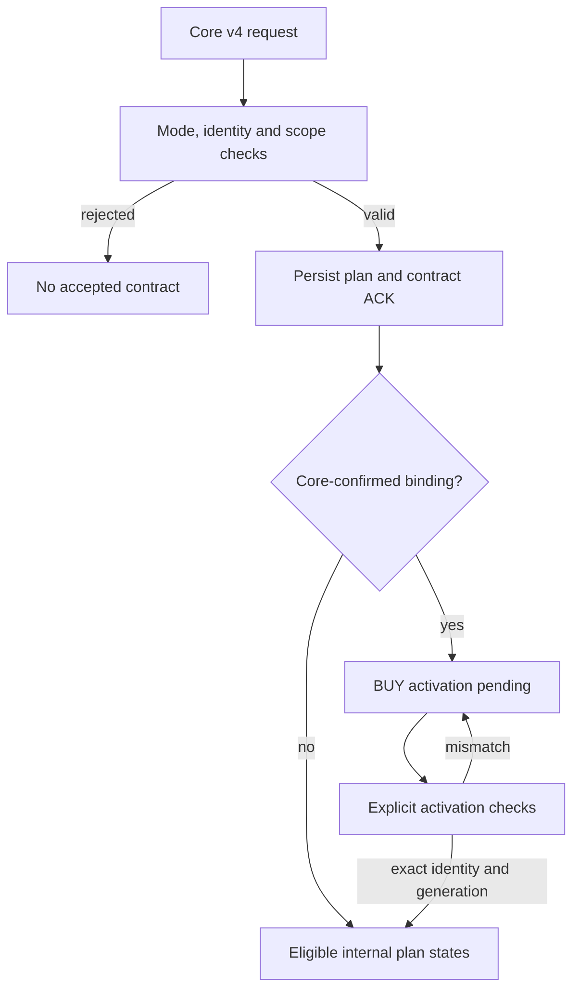

Activation locks the stored plan, items, and jobs. It checks persisted proof, the material fingerprint, authority generation, and exact item/snapshot identities. An already-activated replay is accepted only when the stored identities and activation state agree. Activation permits later processing; sizing, timing, controls, and final broker checks still apply.

**Source:** [`core_handoff_v4.py`](https://github.com/kiseyno-AI/kai-trading-exec/blob/f314d657ac451cdca68246bd2b64c45afa71c7bb/apps/api/app/services/core_handoff_v4.py) — `create_core_execution_plan_v4`, `_core_activation_authority_generation`, `_hold_core_confirmed_buy_activation`, `activate_core_execution_plan_v4`.

### Scoped Core BUY authority

`apply_core_buy_authority_observation` persists an observation ledger and scoped authority state before projecting the result onto matching items. Scope includes mode and account identity. Item matching further limits the mechanism to KIS KRX/KRW BUY candidates with the correct account binding. It does not switch authority for unrelated providers, assets, or protective SELL items.

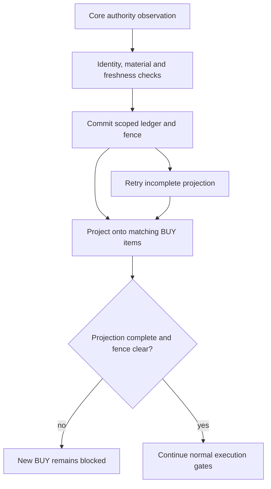

Conflicting observation identities and invalid/stale evidence fail closed. A duplicate does not advance recovery. Recovery needs distinct, sufficiently spaced healthy observations and the configured cooldown. A pending projection remains blocked across interruptions, and a new candidate is projected against the current scoped fence.

Recovery removes only this authority marker and restores its narrowly supported prior state. It does not clear a separate account-loss latch, pause, kill switch, or hourly risk-off fence; it does not resurrect arbitrary terminal items.

**Source:** [`core_buy_authority.py`](https://github.com/kiseyno-AI/kai-trading-exec/blob/f314d657ac451cdca68246bd2b64c45afa71c7bb/apps/api/app/services/core_buy_authority.py) — `apply_core_buy_authority_observation`, `_project_scope`, `_item_matches_scope`, `_project_block`, `_restore_blocked_item`, `core_buy_authority_block_reason`, `project_plan_item_for_core_buy_authority`.

### Revocation and possible exposure

Revocation checks original intake proof, exact plan/item/snapshot identities, and required family coverage, then locks execution state. A provably unsubmitted/unfilled family can have its requested authority and pending jobs revoked. Where orders, fills, or quarantined uncertainty imply possible exposure, the BUY side moves to manual review, jobs are revoked, and protective SELL items are preserved.

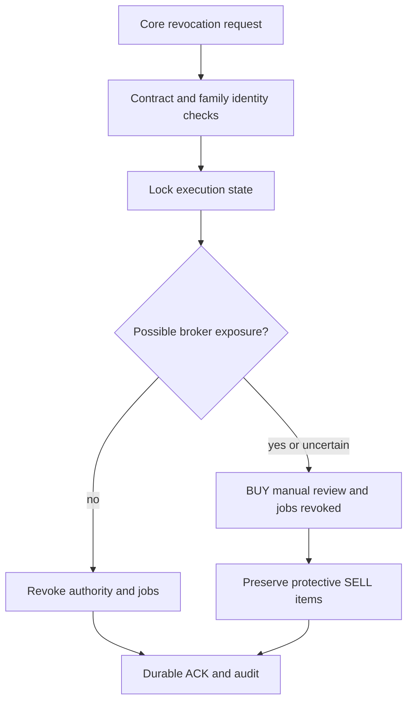

The exposure case returns a conflict with explicit item acknowledgements. It does not assert that the broker exposure has been cancelled.

**Source:** [`core_handoff_v4.py`](https://github.com/kiseyno-AI/kai-trading-exec/blob/f314d657ac451cdca68246bd2b64c45afa71c7bb/apps/api/app/services/core_handoff_v4.py) — `revoke_core_execution_plan_v4`, `_revoke_locked`; [exposure inspection](https://github.com/kiseyno-AI/kai-trading-exec/blob/f314d657ac451cdca68246bd2b64c45afa71c7bb/apps/api/app/services/core_revocation_exposure.py).

## Daily runtime flow

This is conditional work when the relevant workers/routes are enabled. It is not evidence of a deployed cron schedule. Domestic times use `Asia/Seoul` unless the setting changes; US session checks use `America/New_York`, and the Alpaca daily-decision threshold uses UTC. Code defaults leave autonomous trading disabled.

| Phase | Implemented work | Remaining authority |
| --- | --- | --- |
| Startup/restart | Compose services, inspect requested-worker readiness, initialize durable controls, start enabled loops | Schema/position readiness and each worker's own switch |
| Core plan arrival | Persist contract, items, lineage, and eligible jobs; hold Core-confirmed BUYs for activation | Mode, supported scope, contract identity, activation; a future plan is not current monitoring authority |
| Sizing window, default **08:00–20:00 local** | Refresh scoped feedback; select unsized candidates; request bounded sizing outside a long database transaction; revalidate and persist | Agent/sizing switches, current account/candidate evidence, exact provenance, deterministic envelope; this is not an exchange session |
| Domestic opening phase | Classify enabled routes; scheduled KRX next-open uses **09:00** on the target date as its initial boundary | Current target date and authoritative trading-day evidence; unknown calendar proof defers work |
| Target-date domestic session | Dispatch due jobs, collect bounded quotes, reconcile, evaluate triggers, maintain protective exits | Current executable evidence, account/position truth, plan/BUY authority, reservations, final broker checks |
| Late KRX next-open arrival | Keep the candidate eligible for evaluation during its target date | All current calendar/session/quote/account/order gates still apply; no blanket **09:05** expiry exists in these KRX guards |
| Submission and later observations | Commit intent, submit, persist ACK or uncertainty; reconcile fills/status and separately sync positions | Exact order/account identity and usable provider evidence; submission, ACK, and fill are different facts |
| Holding maintenance | Derive family inventory, maintain stop/target coverage, apply due time exits | Entry/calendar/lineage evidence; short-term age includes entry day, signal has no implicit time exit |
| Domestic closed session | Exclude domestic symbols outside enabled sessions; domestic-only live runtime uses the default **60-second** idle cadence, waking sooner for the next enabled session | Optional NXT/off-hours routes still need explicit flags, side policy, and symbol eligibility |
| US session | Generic US next-open checks **09:30 New York time** plus initial grace; KIS US checks regular session; Alpaca US uses broker clock | Provider capability/live flags; v4 US sizing remains unsupported; generic Alpaca BUY fence is distinct from dedicated strategy origin |
| Alpaca crypto cycle | Continuous enabled monitoring/reconciliation; protective exits precede a due daily rebalance after default **00:10 UTC** with usable closed bars | Authenticated scope, strategy/live flags, quote/inventory quality, risk caps, shared broker gates |
| Feedback/review | Refresh scoped feedback from sizing or an explicit caller; export bounded weekly review when invoked | Artifact scope, integrity, freshness, and quality; service existence does not establish a production schedule |

The domestic classifier distinguishes opening auction, regular KRX, selected off-hours KRX, and NXT segments. The session helper gives a conservative route-level answer; exact routing then checks symbol, side, order type/price, and NXT eligibility. Extension, NXT, and KRX off-hours flags are disabled by default.

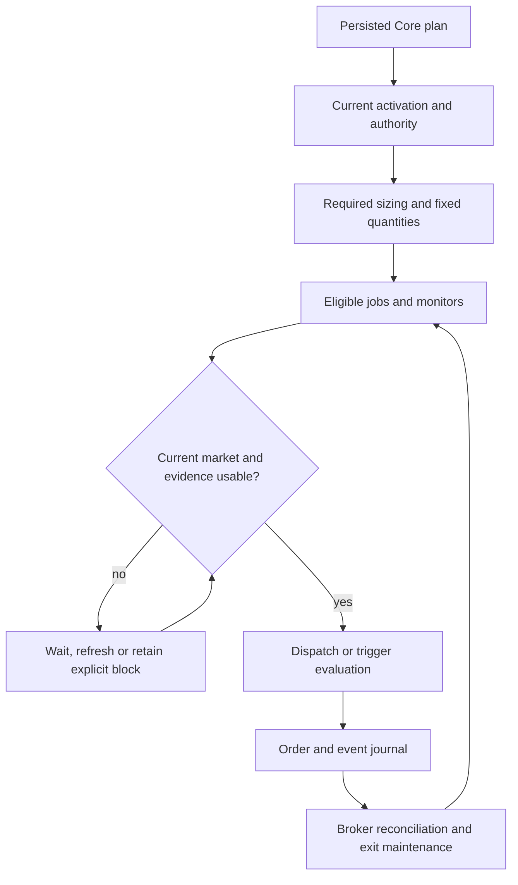

For KRX, elapsed time after opening alone does not expire the candidate. This does not promise a late order: target-date identity, actual session, current executable evidence, controls, and account gates can still prevent submission. US next-open sizing and the separate initial-submission grace retain their own rules.

**Source:** [effective-date monitoring filters](https://github.com/kiseyno-AI/kai-trading-exec/blob/f314d657ac451cdca68246bd2b64c45afa71c7bb/apps/api/app/services/monitoring.py), [`_inside_sizing_window` and `_next_open_window_missed`](https://github.com/kiseyno-AI/kai-trading-exec/blob/f314d657ac451cdca68246bd2b64c45afa71c7bb/apps/api/app/services/watch_exec_agent_sizing.py), [initial next-open guard](https://github.com/kiseyno-AI/kai-trading-exec/blob/f314d657ac451cdca68246bd2b64c45afa71c7bb/apps/api/app/services/execution_jobs.py), [final next-open/capability guards](https://github.com/kiseyno-AI/kai-trading-exec/blob/f314d657ac451cdca68246bd2b64c45afa71c7bb/apps/api/app/services/broker_orders.py), [worker scheduling/session selection](https://github.com/kiseyno-AI/kai-trading-exec/blob/f314d657ac451cdca68246bd2b64c45afa71c7bb/apps/api/app/services/autonomous_runtime.py), [domestic route/session classifier](https://github.com/kiseyno-AI/kai-trading-exec/blob/f314d657ac451cdca68246bd2b64c45afa71c7bb/apps/api/app/services/domestic_order_router.py), [closed-bar daily strategy](https://github.com/kiseyno-AI/kai-trading-exec/blob/f314d657ac451cdca68246bd2b64c45afa71c7bb/apps/api/app/services/alpaca_crypto_strategy.py), [defaults](https://github.com/kiseyno-AI/kai-trading-exec/blob/f314d657ac451cdca68246bd2b64c45afa71c7bb/apps/api/app/core/config.py).

## Sizing and trigger execution

### Sizing produces bounded execution state

Watch sizing needs both Exec-agent and watch-sizing switches plus the configured local-time window. The autonomous path reads and commits candidate state, closes its read session before requesting an agent response, and opens a new write transaction to lock/revalidate the plan. Batches are separated by decision lane and bounded per cycle. Live sizing needs usable account evidence and a server-defined deterministic action envelope.

Response application checks exact candidate identity, provenance, the envelope, and quantity caps. It records the original response and final server decision, and reserves approved notional in the cycle's working account context. A price-watch item can then be monitored; an untriggered next-open item becomes fixed-share pending work and can materialize a scheduled job. Deferrals and terminal rejections retain their own reasons and audit evidence.

For an intraday Core WAIT only, a verified subjective agent rejection can be replaced by conservative server sizing when the deterministic envelope still permits monitoring. This preserves existing Core authority rather than allowing the sizing agent to create a new strategy decision; the override is recorded separately.

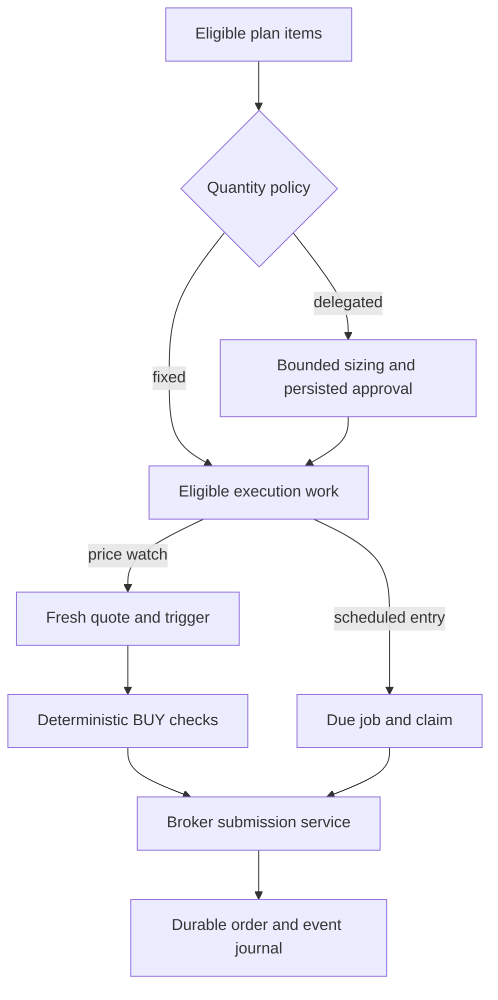

**Source:** [`watch_exec_agent_sizing.py`](https://github.com/kiseyno-AI/kai-trading-exec/blob/f314d657ac451cdca68246bd2b64c45afa71c7bb/apps/api/app/services/watch_exec_agent_sizing.py) — `run_due_watch_exec_agent_sizing`, `_run_due_watch_exec_agent_sizing_short_transactions`, `_server_quantity_only_decision_after_agent_reject`, `_apply_decisions`, `_adjust_approved_watch_quantity`; [job materialization](https://github.com/kiseyno-AI/kai-trading-exec/blob/f314d657ac451cdca68246bd2b64c45afa71c7bb/apps/api/app/services/execution_jobs.py).

### Price watches and scheduled entries

The coordinator uses a cached snapshot to select session-active symbols and collect a bounded quote batch, prioritizing held-position work. A trigger or repair needing writes enters database-backed monitoring and reloads authoritative state. That cycle can reconcile broker truth, maintain protective coverage, evaluate triggers, and enforce its broker-action budget. A cached trigger is not final order authority.

The BUY-watch branch calls `_resolve_watch_buy_order` after persisted price geometry triggers. It does not request a second trigger-time agent BUY decision. Verified sizing, runtime controls, live filters, account/risk evidence, and quantity gates precede request construction; the shared broker service checks its own final boundaries again.

The SELL branch resolves sellable inventory and deterministic quantity limits. Protective stops need their position/authority evidence. Eligible ordinary SELL actions may invoke the trigger-time agent when enabled, validate the response and geometry, then refresh evidence and recheck the trigger after live approval. `stop_sell` and already-due `max_holding_close_sell` skip that discretionary agent decision. Runtime, inventory, quote, session, and broker gates still apply to those exits.

Scheduled entries instead select due jobs, check controls and next-open admission, renew the claim lease around slow preparation, lock the claimed work at the final boundary, and use the same order service. Request construction requires usable fixed sizing and rejects unverified delegated sizing. The persisted order result determines the job outcome.

**Source:** [autonomous quote/snapshot cycle](https://github.com/kiseyno-AI/kai-trading-exec/blob/f314d657ac451cdca68246bd2b64c45afa71c7bb/apps/api/app/services/autonomous_runtime.py), [`_evaluate_monitoring_cycle`, `_resolve_watch_buy_order`, and SELL handling](https://github.com/kiseyno-AI/kai-trading-exec/blob/f314d657ac451cdca68246bd2b64c45afa71c7bb/apps/api/app/services/monitoring.py), [trigger-time contract and emergency exclusions](https://github.com/kiseyno-AI/kai-trading-exec/blob/f314d657ac451cdca68246bd2b64c45afa71c7bb/apps/api/app/services/trigger_time_exec_agent.py), [`dispatch_due_execution_jobs`, `_dispatch_job`, `_build_place_order_request`](https://github.com/kiseyno-AI/kai-trading-exec/blob/f314d657ac451cdca68246bd2b64c45afa71c7bb/apps/api/app/services/execution_jobs.py).

## Runtime controls and recovery scopes

| Control | Submission effect and scope |
| --- | --- |
| Kill switch | The common automated submission helper blocks BUY and SELL. |
| Pause | The market-scoped BUY helper blocks new BUY submission; pause alone is not a blanket SELL block in the common helper. |
| Hourly risk/evidence | Applies to its live KIS domestic equity scope after common controls; missing or stale current-session evidence blocks that scope. |
| Core v4 BUY authority | Applies only to matching Core v4 KIS/KRW/KRX BUY items and their account binding. |
| Account drawdown latch | A separate account/currency loss-recovery boundary; a healthy Core market-authority observation does not clear it. |
| Provider/strategy switches | Live enablement, route capability, account scope, allowed symbols, and trusted origin remain additional gates. |

A recovery event changes only its own fence. Every subsequent order attempt must pass all currently applicable controls, market/quote evidence, account budgets, exposure, and broker checks. Worker liveness and restored market authority are not equivalent to live-order permission.

**Source:** [submission/pause/hourly-risk helpers](https://github.com/kiseyno-AI/kai-trading-exec/blob/f314d657ac451cdca68246bd2b64c45afa71c7bb/apps/api/app/services/runtime_controls.py), [scoped Core authority](https://github.com/kiseyno-AI/kai-trading-exec/blob/f314d657ac451cdca68246bd2b64c45afa71c7bb/apps/api/app/services/core_buy_authority.py), [account-loss gate](https://github.com/kiseyno-AI/kai-trading-exec/blob/f314d657ac451cdca68246bd2b64c45afa71c7bb/apps/api/app/services/account_drawdown_gate.py), [account recovery](https://github.com/kiseyno-AI/kai-trading-exec/blob/f314d657ac451cdca68246bd2b64c45afa71c7bb/apps/api/app/services/account_drawdown_recovery.py), [provider and origin guardrails](https://github.com/kiseyno-AI/kai-trading-exec/blob/f314d657ac451cdca68246bd2b64c45afa71c7bb/apps/api/app/services/broker_orders.py).

## Account drawdown and scoped recovery

The KIS new-BUY gate evaluates configured loss metrics against broker/account evidence. A recoverable loss rejection is persisted with its source order and recovery policy. The active source lookup selects an unsubmitted rejected BUY in the current mode/provider scope; the latch binds an opaque account fingerprint and KRW/USD currency. Where stable identity is unavailable, a same-currency orphan latch is retained across credential changes rather than treating a changed fingerprint as recovery.

Monitoring can inspect durable cooldown before requesting another account snapshot. The serialized order path repeats recovery checks. Ordinary enabled-policy recovery requires cooldown, a fresh timestamped snapshot, tighter loss metrics, and enough distinct spaced healthy observations. A repeated snapshot does not advance progress. Unhealthy evidence or a changed policy resets progress, reconstructed from durable order/audit events.

Defaults are **300 seconds** of cooldown, **two** healthy observations at least **60 seconds** apart, and recovery thresholds calculated as the configured loss threshold **× 0.80**. These are code defaults, not deployed settings or a guaranteed recovery duration.

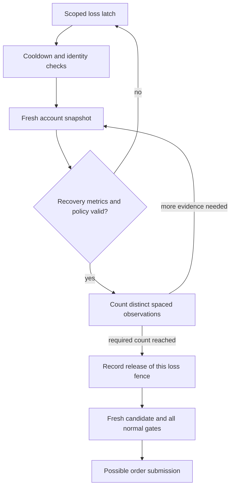

Release is bound to the exact source, generation, and policy. It does not clear pause, kill switch, Core authority, plan revocation, or another account's latch. If a different valid candidate only observes recovery, the service records release and returns `account_drawdown_recovery_fresh_candidate_required` without an order. The original candidate's supported retry must still pass normal gates. A policy-disabled release is a separate audited transition.

**Source:** [loss gate](https://github.com/kiseyno-AI/kai-trading-exec/blob/f314d657ac451cdca68246bd2b64c45afa71c7bb/apps/api/app/services/account_drawdown_gate.py), [recovery state, fresh snapshots, observations, reset, and release](https://github.com/kiseyno-AI/kai-trading-exec/blob/f314d657ac451cdca68246bd2b64c45afa71c7bb/apps/api/app/services/account_drawdown_recovery.py), [`inspect_account_drawdown_recovery`, scope/source lookup, and serialized recovery checks](https://github.com/kiseyno-AI/kai-trading-exec/blob/f314d657ac451cdca68246bd2b64c45afa71c7bb/apps/api/app/services/broker_orders.py), [recovery defaults](https://github.com/kiseyno-AI/kai-trading-exec/blob/f314d657ac451cdca68246bd2b64c45afa71c7bb/apps/api/app/core/config.py).

## Broker submission, acknowledgement and reconciliation

### Intent precedes the external side effect

The shared order service serializes account-capital intent, checks idempotency/retry state, resolves provider/route identity, validates linked plan authority, and applies applicable reservations and risk checks. PostgreSQL uses an account-scope transaction advisory lock; file-backed SQLite has an additional process/file-lock path.

The service commits a pending order and submission event **before** `adapter.place_order`. After that claim, it authenticates/revalidates the current account scope and repeats final checks. Depending on provider, asset, side, and source, these include runtime/Core authority, plan identity, session, fresh executable evidence, opposite orders, family inventory, capital/reservations, exposure, daily BUY notional, volatility/correlation, regime, and drawdown. Not every order uses every check.

Successful broker acceptance is persisted with broker identity, normalized state, local account/decision attribution, and `submit_acknowledged` before optional bookkeeping. A degraded-ACK fallback handles ordinary acknowledgement-persistence failures after acceptance. Same-key replay normally returns stored order state; narrowly proven retry/recovery cases are explicit.

If submission started but there is no conclusive rejection ACK, the error path records `submit_outcome_unknown`, requires manual review, and disables automatic retry for that outcome. A lost response does not prove there is no external order.

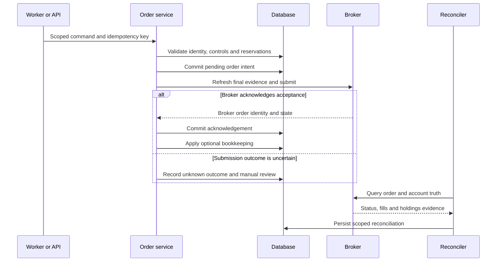

The diagram describes journal boundaries; it does not certify every concurrency interleaving. The audit reproduced degraded-replay and reconciliation races, recorded in the checkpoint with local-only patch status.

**Source:** [`broker_orders.py`](https://github.com/kiseyno-AI/kai-trading-exec/blob/f314d657ac451cdca68246bd2b64c45afa71c7bb/apps/api/app/services/broker_orders.py) — `_serialized_order_intent_scope`, `_acquire_cross_process_order_intent_lock`, `place_broker_order`, `_place_broker_order_serialized`, `_persist_degraded_broker_acknowledgement`.

### Order, fill, and position evidence remain distinct

Reconciliation authenticates against the stored account/route, queries the provider, checks response identity, then records normalized status/fills and related plan state. Canonical fill identity is used for insertion/enrichment, and stored order lineage is copied onto fills. An order ACK is not proof of a fill.

Position synchronization independently reads broker holdings and binds them to execution scope. Incomplete holdings do not justify flattening the local portfolio. A special KIS/KRX partial-exposure path may invalidate earlier flat proof with positive exposure, while incomplete coverage still blocks ordinary full synchronization.

**Source:** [`reconciliation.py`](https://github.com/kiseyno-AI/kai-trading-exec/blob/f314d657ac451cdca68246bd2b64c45afa71c7bb/apps/api/app/services/reconciliation.py) — `reconcile_broker_order`, `_validate_reconcile_payload_identity`, `sync_execution_positions_from_broker_snapshot`, `_parse_fills_from_payload`, `_upsert_order_fills`; [order-to-fill decision lineage](https://github.com/kiseyno-AI/kai-trading-exec/blob/f314d657ac451cdca68246bd2b64c45afa71c7bb/apps/api/app/services/execution_lineage.py).

## Protective exits and decision lineage

A broker position describes the account holding. An execution family identifies the locally attributable strategy entry/exit inventory. Family inventory uses canonical scoped fills, isolation boundaries, exact time evidence, and lane identity; it also checks reconciliation to broker position truth. Inconsistent family lineage blocks a symbol-wide repair that would transfer one family's shares to another. Legacy held-position handling is a separate path and may require review.

Order creation snapshots decision identity. An operational plan row and newer SELL-monitor authority can differ after a replan; fills inherit the stored order lineage so later edits do not rewrite past attribution.

FIFO replay consumes earlier open lots. An unmatched old SELL is incomplete-history evidence and cannot consume a later BUY. Ambiguous chronology/scope can withhold a clean inventory result until appropriate scoped isolation or verified-flat evidence establishes a usable generation.

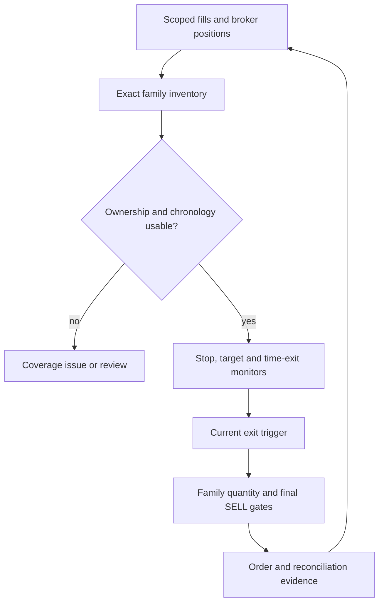

SELL quantity is bounded by both account-symbol inventory and the exact family's remaining route inventory. A partly identified exit cannot borrow another family's shares. Submitted SELL work reserves its family quantity within the cycle.

After an accepted partial-profit submission, same-family stop bookkeeping may raise a sibling stop to the configured breakeven level and set the remaining quantity. This reflects accepted submitted quantity; it is not evidence that the full profit-taking order has filled. Reconciliation establishes later fill truth.

The short-term lane's holding policy is clamped to two or three inclusive trading sessions, with a maximum of three. The entry session is session one, so the deadline advances `max_holding_sessions - 1` sessions. A disabled policy cannot remove that short-term maximum. The signal lane has no implicit time exit without a policy. A stored close-exit date and its calendar authority do not promise a fill at a particular minute.

**Source:** [family inventory, monitor maintenance, quantity limits, and stop rearm](https://github.com/kiseyno-AI/kai-trading-exec/blob/f314d657ac451cdca68246bd2b64c45afa71c7bb/apps/api/app/services/monitoring.py) — `_post_entry_family_inventories`, `_maintain_post_entry_exit_monitors`, `_sell_remaining_quantity`, `_reserve_family_quantity`, `_rearm_stop_after_partial_take_profit`, `_post_entry_max_holding_sessions`, `_ensure_post_entry_max_holding_monitor`; [lineage](https://github.com/kiseyno-AI/kai-trading-exec/blob/f314d657ac451cdca68246bd2b64c45afa71c7bb/apps/api/app/services/execution_lineage.py); [`replay_open_long_fill_inventory`](https://github.com/kiseyno-AI/kai-trading-exec/blob/f314d657ac451cdca68246bd2b64c45afa71c7bb/apps/api/app/services/fifo_inventory.py).

## Provider isolation and feature map

The main and two Alpaca coordinators have independent startup flags, lifecycle state, quote caches, reconciliation cadence, and account-scoped checkpoints. Shared tables do not make account or asset authority interchangeable.

| Runtime path | Data and execution scope | Material boundary |
| --- | --- | --- |
| Main coordinator | Configured primary adapter; Core dispatch and domestic monitoring | Plan identity, controls, account/route evidence, and shared order service |
| Alpaca crypto | Authenticated account, crypto, `ALPACA`, allowed symbols | Continuous monitoring; strategy and live flags are separate from monitoring enablement |
| Alpaca US equity | Authenticated account, `us_equity`, `US`, stock facade and broker clock | US-specific identity/settings; strategy returns `market_closed` when the broker clock is closed |
| KIS US equity | Explicit KIS US item and NASD/NYSE/AMEX route | Whole-share day-limit orders, notional cap, trading flag, extra live/account confirmation; separate from v4 delegated sizing |
| Upbit | Explicit supported KRW crypto paper route | Paper guard requires `runtime_mode="paper"`; a generic live flag cannot implement live submission |

Alpaca cycles reconcile pending orders/positions, require authenticated account scope, load quotes, and invoke strategy. Missing or mismatched identity degrades or blocks the cycle. Strategy validates enablement, account/quote/inventory evidence, and protective exits before a due daily rebalance. Daily decisions require usable open orders and fresh closed bars, persist features/decisions, and suppress repeats for the same bar/account/strategy scope. Orders retain trusted internal origin and enter the shared broker service.

Generic live Alpaca US BUY sources beginning `monitoring:`, `execution-job:`, or `short-term-watcher:` have a capability fence because that path lacks trusted executable-quote support. The dedicated `alpaca_us_equity_strategy` origin is a separate guarded path. Neither statement asserts that live trading is enabled in a deployment.

| Feature | Primary modules | Durable/read boundary |
| --- | --- | --- |
| Core registration/activation/revocation | `core_handoff_v4`, `core_revocation_exposure` | Plan/items/jobs, contract ACKs, exposure-aware authority |
| Scoped Core BUY observations | `core_buy_authority` | Observation ledger, fence state, item projection |
| Scheduled entries | `execution_jobs` | Due work, claim/lease, order identity |
| Quote monitoring and exits | `autonomous_runtime`, `monitoring`, `monitoring_price_source` | Runtime snapshots, quote coverage, checkpoints, family monitors |
| Sizing and optional agent decisions | `watch_exec_agent_sizing`, `trigger_time_exec_agent` | Verified response identity, bounded final decision |
| Session/provider routing | `domestic_order_router`, `trading_sessions`, broker adapters | Requested venue and executable evidence |
| Broker lifecycle and bounded retries | `broker_auth`, `broker_orders`, `rejected_order_retries` | Sessions, intent/ACK/error journals, exact retry lineage |
| Fill/position truth | `reconciliation`, `fill_idempotency`, `position_identity` | Canonical fills and scoped positions |
| Risk and loss recovery | `account_drawdown_gate`, `account_drawdown_recovery`, `portfolio_risk` | Account/currency latches and advisory risk views |
| Lane ownership and FIFO | `execution_lineage`, `strategy_family_attribution`, `fifo_inventory` | Entry family, chronology, attributable inventory |
| Feedback and weekly review | `trade_outcome_feedback`, `weekly_trade_review` | Scoped advisory artifacts with integrity metadata |
| Bounded repair and remediation | `execution_fill_repair`, `position_truth_remediation` | Explicit evidence/case identity and audit records |

This map groups source ownership for navigation. It does not label every path manually audited or every optional service deployed.

**Source:** [Alpaca crypto worker](https://github.com/kiseyno-AI/kai-trading-exec/blob/f314d657ac451cdca68246bd2b64c45afa71c7bb/apps/api/app/services/alpaca_crypto_runtime.py), [US facade/worker](https://github.com/kiseyno-AI/kai-trading-exec/blob/f314d657ac451cdca68246bd2b64c45afa71c7bb/apps/api/app/services/alpaca_us_equity_runtime.py), [trend strategy and protective exits](https://github.com/kiseyno-AI/kai-trading-exec/blob/f314d657ac451cdca68246bd2b64c45afa71c7bb/apps/api/app/services/alpaca_crypto_strategy.py), [provider guardrails and capability gates](https://github.com/kiseyno-AI/kai-trading-exec/blob/f314d657ac451cdca68246bd2b64c45afa71c7bb/apps/api/app/services/broker_orders.py), [service module directory](https://github.com/kiseyno-AI/kai-trading-exec/tree/f314d657ac451cdca68246bd2b64c45afa71c7bb/apps/api/app/services).

## Feedback and review artifacts

Outcome feedback derives account FIFO and exact strategy-family outcomes separately. It includes attribution/duplicate-conflict coverage, portfolio/risk context, and lane learning. Aggregate/cross-scope summaries do not grant execution authority. A lane's learning eligibility requires attribution, account-scope, and quality gates.

Freshness management regenerates missing/stale bounded artifacts. Reads check expected version/mode, integrity, requested account, and age. Invalid or ineligible evidence becomes unavailable/blocked context; the request builder then selects the exact lane. The sizing coordinator refreshes feedback before eligible sizing, and sizing/eligible exit assessments consume the scoped snippet.

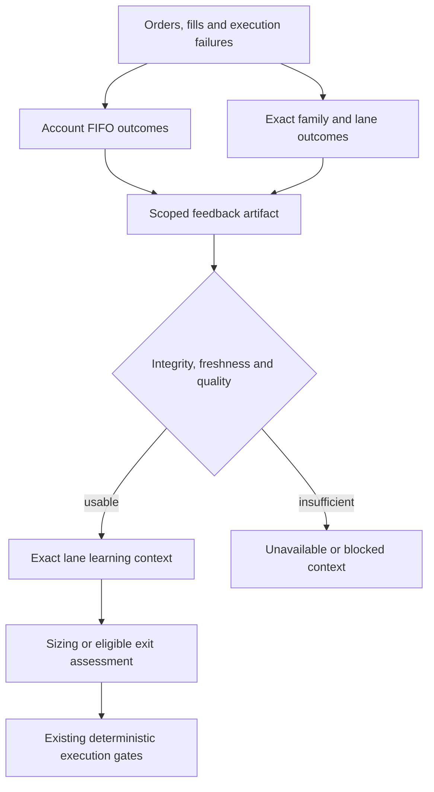

Weekly trade review is a separate bounded read-only export of Exec-owned evidence. It limits time range/rows, supports timeout/progress, and validates artifact schema/integrity. Its existence does not establish an installed weekly scheduler.

**Source:** [`generate_trade_outcome_feedback`, freshening, loading, and lane eligibility](https://github.com/kiseyno-AI/kai-trading-exec/blob/f314d657ac451cdca68246bd2b64c45afa71c7bb/apps/api/app/services/trade_outcome_feedback.py), [exact lane selection](https://github.com/kiseyno-AI/kai-trading-exec/blob/f314d657ac451cdca68246bd2b64c45afa71c7bb/apps/api/app/services/strategy_lane_authority.py), [sizing-cycle refresh](https://github.com/kiseyno-AI/kai-trading-exec/blob/f314d657ac451cdca68246bd2b64c45afa71c7bb/apps/api/app/services/autonomous_runtime.py), [weekly review generation/validation](https://github.com/kiseyno-AI/kai-trading-exec/blob/f314d657ac451cdca68246bd2b64c45afa71c7bb/apps/api/app/services/weekly_trade_review.py).

## Evidence and review limits

Each diagram follows selected source paths at the pinned baseline. A worker, route, or setting demonstrates implementation availability; it does not establish deployed enablement, a successful provider result, or complete correctness.

Graphify supplied code-relationship discovery, and the catalog's boundaries were traced against the cited source. The [audit checkpoint](../audit/2026-11-08-checkpoint.md) separately records manual coverage, automated checks, focused tests, and unpublished patches. Full adapter behavior, all handlers, migrations/rollback, cancellation/retry combinations, deployment configuration, operator workflows, and every concurrency interleaving have not completed review.

The Markdown links, diagram fences, and compact graph structure were checked programmatically. The execution environment was unavailable, so Mermaid visual rendering and final application verification were not run for this documentation checkpoint. No live brokerage or production database was used for this documentation.
